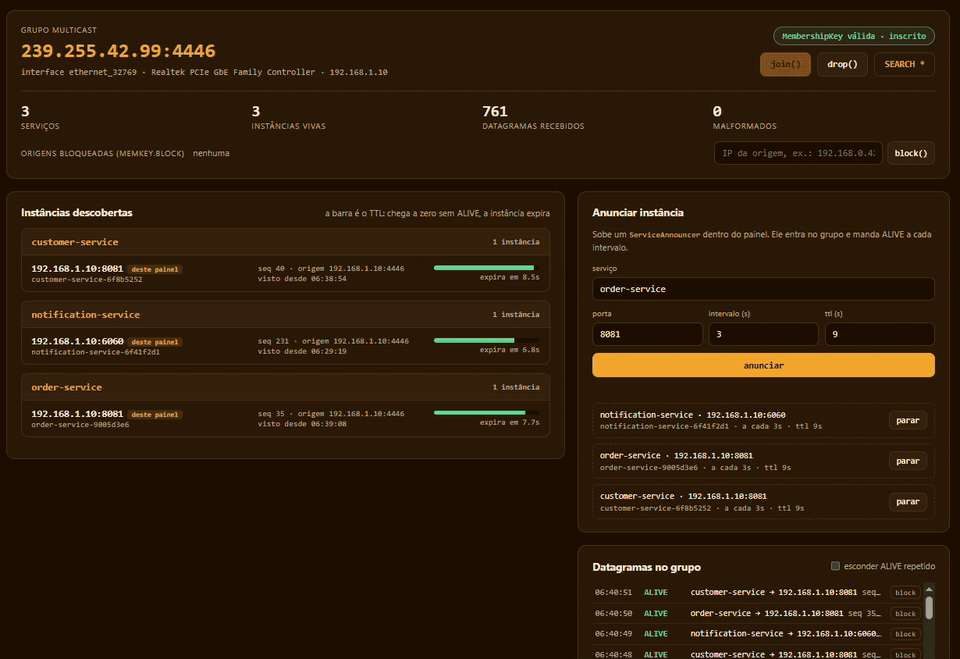

# caramelo-server-discovery 🐶

Service discovery em rede local com **UDP multicast** e Java NIO.2 (`DatagramChannel` + `MembershipKey`).
Cada instância anuncia "estou vivo em host:porta" num grupo multicast, no estilo do **SSDP**, do **mDNS** e da descoberta por multicast do **Hazelcast** e do **JGroups**.



```
┌──────────────────┐   ALIVE a cada 5s    ┌─────────────────────────┐
│ announce          │ ───────────────────▶ │  grupo 239.255.42.99    │
│ orders-service    │ ◀── SEARCH * ─────── │  porta 4446 (UDP)       │
│ (ServiceAnnouncer)│   BYE no shutdown    └───────────┬─────────────┘
└──────────────────┘                                   │ join() → MembershipKey
                                                       ▼
                    ┌───────────────────────────────────────────────┐
                    │ dashboard (DashboardServer)                   │
                    │  DiscoveryListener → ServiceRegistry (TTL)    │
                    │  HTTP :8090  ── SSE /api/events ──▶ navegador │
                    └───────────────────────────────────────────────┘
```

O navegador não consegue entrar num grupo multicast. Quem é membro do grupo é o backend do painel, e o frontend recebe tudo por **Server-Sent Events**.

## Estrutura

```
backend/   Java 21, Maven, zero dependências (só JDK + jdk.httpserver)
  protocol/  DiscoveryMessage (sealed: Alive | Bye | Search) + MessageCodec (texto estilo SSDP)
  net/       MulticastSettings + NetworkInterfaces (escolha da interface)
  server/    ServiceAnnouncer  → lado servidor: anuncia, responde SEARCH, manda BYE
  client/    DiscoveryListener → lado cliente: join, receive, block/unblock, drop
  registry/  ServiceRegistry   → instâncias vivas, renovação por seq, expiração por TTL
  dashboard/ DashboardServer   → API REST + SSE + arquivos estáticos do frontend
frontend/  HTML + CSS + JS puro, sem build
```

## Comportamento

- **Heartbeat + TTL**: UDP não avisa quando alguém morre. Instância que para de mandar ALIVE expira sozinha. Padrão: TTL = 3x o intervalo (tolera 2 pacotes perdidos).
- **BYE**: desligamento gracioso remove a instância na hora, sem esperar o TTL.
- **SEARCH com jitter**: quem entra no grupo pergunta "quem está aí?" e não espera o próximo heartbeat. As respostas saem com atraso aleatório (o `MX` do SSDP) para não chegarem todas no mesmo milissegundo.
- **`seq` por instância**: UDP não garante ordem. ALIVE atrasado ou duplicado é descartado.
- **`IP_MULTICAST_TTL = 1`**: o anúncio não atravessa roteador. Descoberta é assunto da LAN.
- **`IP_MULTICAST_LOOP = true`**: processos na mesma máquina também recebem.

## Protocolo

Texto, um datagrama por mensagem (< 1400 bytes, sem fragmentação):

```
CARAMELO/1 ALIVE              CARAMELO/1 BYE                CARAMELO/1 SEARCH
service: orders-service       service: orders-service       service: *
instance: orders-service-3f2a instance: orders-service-3f2a searcher: listener-9b1c
host: 192.168.0.10
port: 8080
ttl: 15
seq: 42
```

## Rodando

Pré-requisitos: JDK 21+ e Maven.

```bash
cd backend && mvn -q package
```

Painel (abre em http://localhost:8090):

```bash
java -jar backend/target/caramelo-discovery.jar dashboard
```

Instâncias (cada uma num terminal, ou em outras máquinas da mesma rede):

```bash
java -jar backend/target/caramelo-discovery.jar announce --service orders-service --port 8080
```

```bash
java -jar backend/target/caramelo-discovery.jar announce --service payments-service --port 9090 --interval 2
```

Cliente de terminal, sem painel:

```bash
java -jar backend/target/caramelo-discovery.jar watch
```

Opções comuns: `--group 239.255.42.99`, `--mport 4446`, `--iface <nome>` (veja `interfaces`). Também valem como variáveis `CARAMELO_GROUP`, `CARAMELO_MPORT`, `CARAMELO_IFACE`.
No console do Windows, `-Dstdout.encoding=UTF-8` corrige a acentuação dos logs.

### API do painel

| Método | Rota | Efeito |
|---|---|---|
| GET | `/api/events` | stream SSE (snapshot inicial + packet/registry/status) |
| GET | `/api/snapshot`, `/api/instances` | estado atual |
| POST | `/api/membership/join` / `leave` | `join()` + SEARCH / `drop()` |
| POST | `/api/search?service=*` | descoberta ativa |
| POST | `/api/sources/block?address=IP` / `unblock` | filtro de origem na `MembershipKey` |
| POST | `/api/announcers?service=&port=&interval=&ttl=` | sobe um announcer dentro do painel |
| DELETE | `/api/announcers/{instanceId}` | para o announcer com BYE |

O frontend também roda fora do backend: abra `frontend/index.html?api=http://host:8090` (a API libera CORS).

## Roteiro de demo

1. Suba o painel e dois `announce`. As instâncias aparecem e a barra de TTL reinicia a cada ALIVE.
2. **drop()**: o painel sai do grupo, para de receber e as instâncias expiram pelo TTL.
3. **join()**: volta ao grupo, manda SEARCH e redescobre tudo em menos de 1 segundo.
4. **Ctrl+C** num `announce`: chega o BYE e a instância some na hora. Mate o processo à força (`taskkill /F` / `kill -9`) e ela só some quando o TTL vence.
5. **block** numa linha do log: o kernel descarta tudo que vem daquele IP.

## Pegadinhas

- **Interface errada**: no Windows, adaptadores Hyper-V/WSL/VirtualBox podem roubar a escolha. O código prioriza a interface física; force com `--iface`.
- **Firewall**: libere UDP 4446 de entrada para o `java` testar entre máquinas. Na mesma máquina funciona sem isso.
- **block é por IP**: todas as instâncias da mesma máquina têm o mesmo IP de origem e são bloqueadas juntas.
- **Linux e `IP_MULTICAST_ALL`**: um socket sem `join` ainda recebe o grupo se outro socket da máquina estiver inscrito na mesma porta. Por isso o listener descarta datagramas quando não tem `MembershipKey` válida.
- **Wi-Fi corporativo e cloud**: muitos access points e quase todas as VPCs (AWS, GCP, Azure) bloqueiam multicast. É por isso que Hazelcast e JGroups têm modos TCP/IP e Kubernetes como alternativa.

## Os grupos de verdade

| Protocolo | Grupo:porta |
|---|---|
| SSDP (UPnP) | 239.255.255.250:1900 |
| mDNS (Bonjour/Avahi) | 224.0.0.251:5353 |
| Hazelcast (multicast join) | 224.2.2.3:54327 |
| JGroups (stack UDP) | 228.8.8.8:45588 |
| este projeto | 239.255.42.99:4446 |

## Licença

[MIT](LICENSE)
